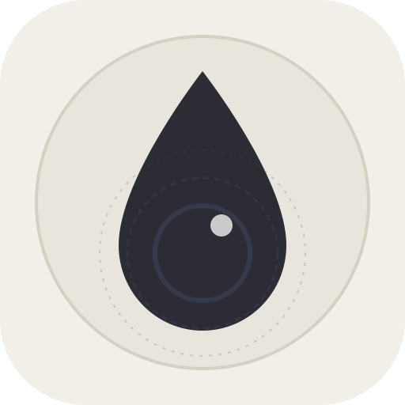

# Inkwasher (墨洗) 🖌️

> **Pen-and-ink with living water — GPU fluid watercolor studio for stylus and touch.**

<p align="center">
  
</p>

**Inkwasher** is a web-based natural medium watercolor painting studio built on a real-time WebGL2 Navier-Stokes fluid simulation. Ink flows, bleeds, and blooms dynamically only where the paper is wet, gradually drying and settling into the paper fibers.

Designed from the ground up for **Android tablets (S-Pen)**, **iPads (Apple Pencil)**, and **desktop drawing tablets**.

---

## ✨ Features

- ⚡ **Zero-Latency Stylus Pipeline**
  - Uses `desynchronized: true` to bypass OS compositor queuing and draw directly to the front scanout buffer (the Web equivalent of Android's `requestUnbufferedDispatch`).
  - Unpacks high-frequency hardware digitizer reports (`e.getCoalescedEvents()`) for buttery smooth, instant lines with zero corner-cutting.
  - Full stylus pressure sensitivity and barrel button / eraser mode toggling.

- 📐 **Fixed Canvas Studio with Pan, Zoom & Rotate**
  - Fixed-resolution watercolor sheet (default **1600 × 1600 px**, with **2400 × 2400 px Master**, **Tablet Portrait**, etc.).
  - **Two-Finger Touch Gestures**: Pinch to zoom (10% to 800%), drag to pan, twist to rotate the drawing board at any comfortable angle.
  - **Spring-Loaded Keyboard Shortcuts**:
    - Hold `Space` + Stylus Drag $\rightarrow$ **Pan Canvas**
    - Hold `Ctrl + Space` + Stylus Drag $\rightarrow$ **Smooth Zoom**
    - Hold `R` + Stylus Drag $\rightarrow$ **Rotate Canvas**
    - Releasing the key instantly springs back to your active brush!
    - `Ctrl + 0` $\rightarrow$ **Fit & Center View**

- 🖌️ **7 Expressive Brushes**
  1. **Fine Dip Pen (`1`)**: Deep ink, crisp calligraphic lines that pool when resting.
  2. **Clear Water Brush (`2`)**: Pure living water without pigment; disperses, bleeds, and blends existing ink.
  3. **Sumi Wash Brush (`3`)**: Calligraphic wash laying down dilute ink and water simultaneously for tonal rendering.
  4. **Wet-in-Wet Flooder (`4`)**: High-volume water brush designed for dramatic watercolor blooming.
  5. **White Gouache (`5` / `W`)**: Opaque white pigment for highlights, water foam, and mist over dark ink.
  6. **Ink Splatter (`6`)**: Sprays organic clusters of randomized ink and water droplets.
  7. **Soft Blender (`7`)**: Stirs active wet edges without flooding paper with new water.

- ↩️ **GPU-Accelerated Undo / Redo**
  - Instant GPU texture-to-texture blitting (zero CPU memory stalls or frame drops).
  - **Two-Finger Tap** anywhere on the canvas $\rightarrow$ **Instant Undo**.
  - **Three-Finger Tap** $\rightarrow$ **Redo**.
  - Standard hotkeys: `Ctrl+Z` (Undo), `Ctrl+Y` / `Ctrl+Shift+Z` (Redo).

- 🔒 **Bake / Fix Layer (`D`)**
  - Settles active mobile ink permanently into the paper fibers so you can wash or glaze over it without disturbing the underdrawing.

- 💾 **Lossless Master Export (`E` / `Ctrl+S`)**
  - Exports a clean, full-resolution unrotated 1:1 PNG of the artwork without UI or viewport scaling artifacts.

- 🔄 **Isolated Upstream Sync (`_reference/`)**
  - Upstream reference files from [johnowhitaker/inkwash](https://github.com/johnowhitaker/inkwash) are preserved inside `_reference/`.
  - Running `npm run sync` or triggering the included GitHub Action updates `_reference/` without ever touching root Inkwasher files.

---

## 🚀 Quickstart

### Running Locally

Inkwasher has **zero external dependencies** — it runs out of the box with any local HTTP server:

```bash
# Clone the repository
git clone https://github.com/anshumangaurav13/inkwasher.git
cd inkwasher

# Start the local server
npm start
# or: node server.js
```

Open your browser at `http://localhost:8080`.

### Running on an Android Tablet or iPad

1. Start `node server.js` on your computer (it listens on `0.0.0.0:8080`).
2. The terminal will display your tablet network URL (e.g., `http://192.168.x.x:8080`).
3. Open Chrome on your tablet and navigate to the URL.
4. Tap `⋮` $\rightarrow$ **Add to Home screen** / **Install App** to launch it full-screen without address bars.

---

## ⌨️ Shortcuts & Gestures Cheat Sheet

| Action | Shortcut / Gesture |
| :--- | :--- |
| **Switch Brushes** | Keys `1` through `7` |
| **Toggle Pen / Water** | Key `B` or Stylus Barrel Button |
| **White Gouache** | Key `W` |
| **Bake / Fix Layer** | Key `D` |
| **Undo** | `Ctrl + Z` or **2-Finger Tap** |
| **Redo** | `Ctrl + Y` or **3-Finger Tap** |
| **Pan Canvas** | Hold `Space` + Drag or **2-Finger Drag** |
| **Zoom Canvas** | Hold `Ctrl + Space` + Drag or **2-Finger Pinch** |
| **Rotate Canvas** | Hold `R` + Drag or **2-Finger Twist** |
| **Reset / Fit View** | `Ctrl + 0` |
| **Export PNG** | Key `E` or `Ctrl + S` |
| **New Canvas Modal** | Key `N` |
| **Toggle Sidebar** | Key `Tab` |
| **Fullscreen** | Key `F` |
| **Clear Canvas** | Key `C` |

---

## 📁 Project Architecture

```
inkwasher/
├── index.html               # Main studio app shell
├── manifest.webmanifest     # PWA manifest
├── sw.js                    # Offline service worker
├── icon.svg                 # Inkwasher vector logo
├── icon-192.png             # Raster app icon (192x192)
├── icon-512.png             # Raster app icon (512x512)
├── server.js                # Zero-dependency local network daemon
├── css/
│   └── style.css            # Studio workbench styling & responsive layout
├── js/
│   ├── app.js               # Main coordinator & low-latency pointer pipeline
│   ├── viewport.js          # Pan, zoom, rotate, and spring-loaded key engine
│   ├── gl-core.js           # WebGL2 setup, desynchronized context & FBO pooling
│   ├── shaders.js           # GLSL shaders (advection, diffusion, paper texture)
│   ├── fluid-sim.js         # Navier-Stokes fluid & dye simulation step
│   ├── brushes.js           # 7 Brush dynamics & spline interpolation
│   ├── history.js           # GPU texture snapshot Undo/Redo manager
│   └── ui.js                # Left sidebar toolbar & modal dialogues
├── scripts/
│   └── sync-upstream.js     # Script to pull upstream updates into _reference/
├── .github/workflows/
│   └── sync-upstream.yml    # One-click GitHub Action for upstream syncing
└── _reference/              # Upstream inkwash reference codebase
```

---

## 📄 License & Credits

- **Inkwasher** is licensed under the [MIT License](LICENSE) &copy; 2026 Anshuman Gaurav.
- Inspired by and derived from [John Whitaker's inkwash](https://github.com/johnowhitaker/inkwash) (preserved in `_reference/` under its original MIT License).
